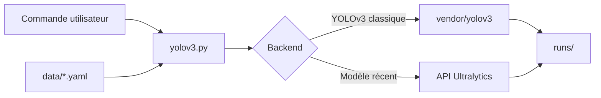

# AI Detection YOLO

Interface Python unique pour **entraîner**, **évaluer** et **utiliser en
inférence** YOLOv3 classique ou un modèle Ultralytics récent.

Ce README répond à deux questions :

- **What does the tool do?** Il unifie les commandes `train`, `predict` et
  `val` pour plusieurs générations de YOLO.
- **How do I use it?** Les commandes essentielles sont documentées ci-dessous.

Pour comprendre le fonctionnement interne, les choix d'architecture, le cycle
d'entraînement, les métriques et les limites du projet, consultez
[l'explication technique](docs/PROJECT_EXPLANATION.md).

## Fonctionnalités

- YOLOv3, YOLOv3-SPP et YOLOv3-Tiny via `vendor/yolov3` ;
- modèles Ultralytics récents et checkpoints personnalisés ;
- entraînement avec poids pré-entraînés ou depuis zéro ;
- prédiction sur image, vidéo, dossier, URL, écran ou webcam ;
- validation avec précision, rappel et mAP ;
- exécution sur CPU, Apple MPS ou GPU CUDA ;
- chemins de datasets portables malgré leur stockage hors du dépôt ;
- sorties, datasets, vidéos et modèles exclus de Git.



## Installation

Python 3.12 est recommandé sur cette machine. Le projet accepte Python
`>=3.9,<3.15`.

```bash
python3.12 -m venv .venv-yolov3
source .venv-yolov3/bin/activate
python -m pip install --upgrade pip
python -m pip install -e .
python yolov3.py check
```

La dernière commande affiche les versions installées, la disponibilité de MPS
et les modèles présents dans `weights/`.

## Organisation locale attendue

Le code et les données sont volontairement séparés :

```text
AI/
├── AI-Detection-YOLO/
│   ├── data/                  # configurations YAML
│   ├── src/                   # pipeline Python
│   ├── vendor/yolov3/         # backend YOLOv3 classique
│   ├── weights/               # modèles locaux, ignorés par Git
│   ├── runs/                  # sorties, ignorées par Git
│   └── yolov3.py
│
└── AI-Detection-YOLO-Dataset-Preparation/
    ├── dataset/
    ├── dataset_gender/
    ├── datasets/coco128/
    ├── prepare_openimages_gender.py
    └── dataset_inspection.py
```

La préparation des données est décrite dans le README du dossier
`AI-Detection-YOLO-Dataset-Preparation`.

## Démarrage rapide

### Vérifier l'environnement

```bash
source .venv-yolov3/bin/activate
python yolov3.py check
```

### Entraîner un modèle récent

```bash
python yolov3.py train \
  --model yolo26n \
  --data data/gender.yaml \
  --epochs 30 \
  --batch-size 8 \
  --imgsz 640 \
  --device cpu \
  --name yolo26-gender
```

Le meilleur checkpoint est normalement écrit dans :

```text
runs/train/yolo26-gender/weights/best.pt
```

### Tester un checkpoint sur une image

```bash
python yolov3.py predict \
  --model weights/gender_best.pt \
  --source ../AI-Detection-YOLO-Dataset-Preparation/dataset_gender/images/val/010d9a7f0d2e0622.jpg \
  --device cpu \
  --name test-image
```

Le résultat annoté est enregistré dans `runs/predict/test-image/`.

### Évaluer un checkpoint

```bash
python yolov3.py val \
  --model runs/train/yolo26-gender/weights/best.pt \
  --data data/gender.yaml \
  --batch-size 8 \
  --device cpu \
  --name evaluation-gender
```

## Choisir un modèle

| Valeur | Backend utilisé |
|---|---|
| `--model yolov3` | YOLOv3 classique |
| `--model yolov3-spp` | YOLOv3-SPP classique |
| `--model yolov3-tiny` | YOLOv3-Tiny classique |
| `--weights chemin.pt` | checkpoint YOLOv3 classique |
| `--model yolo26n` | modèle Ultralytics dans `weights/yolo26n.pt` |
| `--model chemin/best.pt` | checkpoint Ultralytics personnalisé |

Exemple YOLOv3 classique :

```bash
python yolov3.py train \
  --model yolov3 \
  --data data/gender.yaml \
  --epochs 100 \
  --batch-size 8 \
  --device cpu \
  --name yolov3-gender
```

Pour partir de poids aléatoires :

```bash
python yolov3.py train \
  --model yolov3 \
  --data data/dataset.yaml \
  --scratch \
  --device cpu
```

## Inférence

### Image

```bash
python yolov3.py predict \
  --model weights/gender_best.pt \
  --source image.jpg \
  --conf 0.25 \
  --device cpu
```

### Vidéo

```bash
python yolov3.py predict \
  --model weights/gender_best.pt \
  --source video.mp4 \
  --vid-stride 2 \
  --device cpu \
  --name test-video
```

### Webcam

```bash
python yolov3.py predict \
  --model weights/gender_best.pt \
  --source 0 \
  --device mps \
  --view \
  --name webcam
```

### Filtrer des classes et sauver les labels

```bash
python yolov3.py predict \
  --model yolov3 \
  --source image.jpg \
  --classes 0 2 3 \
  --save-txt \
  --device cpu
```

## Configurations de datasets

| Fichier | Rôle |
|---|---|
| `data/dataset.yaml` | modèle générique pour un dataset personnalisé |
| `data/gender.yaml` | dataset Open Images en deux classes d'apparence |
| `data/coco128.yaml` | petit dataset COCO pour les tests rapides |

Structure attendue :

```text
dataset/
├── images/{train,val,test}/
└── labels/{train,val,test}/
```

Chaque fichier de label contient une ligne par objet :

```text
class_id x_centre y_centre largeur hauteur
```

Les quatre coordonnées sont normalisées entre `0` et `1`.

## Options utiles

### Entraînement

| Option | Défaut | Rôle |
|---|---:|---|
| `--data` | `data/dataset.yaml` | configuration du dataset |
| `--epochs` | `100` | nombre d'époques |
| `--batch-size` | `8` | taille des lots |
| `--imgsz` | `640` | résolution d'entrée |
| `--workers` | `4` | processus de chargement |
| `--cache` | désactivé | cache `ram` ou `disk` |
| `--freeze` | `0` | premières couches à geler |
| `--scratch` | désactivé | entraînement sans poids pré-entraînés |
| `--project` | `runs/train` | dossier de sortie |
| `--name` | `custom-yolo` | nom de l'expérience |

### Prédiction

| Option | Défaut | Rôle |
|---|---:|---|
| `--source` | obligatoire | image, vidéo, dossier, URL ou caméra |
| `--conf` | `0.25` | seuil minimal de confiance |
| `--classes` | toutes | classes à conserver |
| `--vid-stride` | `1` | intervalle entre les frames traitées |
| `--view` | désactivé | affichage en direct |
| `--save-txt` | désactivé | export texte des détections |
| `--half` | désactivé | calcul FP16 sur matériel compatible |

### Périphérique

| Option | Matériel |
|---|---|
| `--device cpu` | processeur |
| `--device mps` | GPU Apple Silicon |
| `--device 0` | premier GPU NVIDIA |
| `--device 0,1` | plusieurs GPU CUDA si supporté |

Utilisez `mps` uniquement si `python yolov3.py check` affiche
`MPS disponible : True`.

## Sorties

```text
runs/
├── train/<experience>/
│   ├── weights/best.pt
│   ├── weights/last.pt
│   ├── args.yaml
│   ├── results.csv
│   └── courbes et matrices de confusion
├── predict/<execution>/
│   └── images ou vidéos annotées
└── val/<evaluation>/
    └── métriques et graphiques
```

- `best.pt` : meilleur checkpoint selon la validation ;
- `last.pt` : état de la dernière époque ;
- `results.csv` : évolution des pertes et métriques ;
- `args.yaml` : paramètres de l'expérience.

Tous ces fichiers sont ignorés par Git.

## Stocker les modèles sur Hugging Face

Les poids ne doivent pas être ajoutés au dépôt GitHub. Pour un stockage privé et
versionné :

```bash
hf auth login

hf repos create <compte>/ai-detection-yolo-models \
  --type model \
  --private

hf upload <compte>/ai-detection-yolo-models \
  runs/train/yolo26-gender/weights/best.pt \
  yolo26-gender/best.pt
```

Téléchargement :

```bash
hf download <compte>/ai-detection-yolo-models \
  yolo26-gender/best.pt \
  --local-dir weights/
```

## Commandes d'aide

```bash
python yolov3.py --help
python yolov3.py train --help
python yolov3.py predict --help
python yolov3.py val --help
```

Après l'installation éditable, `yolov3 --help` est équivalent à
`python yolov3.py --help`.

## Problèmes fréquents

### Dépendances absentes

```bash
source .venv-yolov3/bin/activate
python -m pip install -e .
python yolov3.py check
```

### Dataset introuvable

Vérifiez que `AI-Detection-YOLO` et
`AI-Detection-YOLO-Dataset-Preparation` sont voisins. Sinon, modifiez la clé
`path:` dans le YAML concerné.

### Manque de mémoire

Réduisez dans cet ordre :

1. `--batch-size` ;
2. l'utilisation de `--cache ram` ;
3. `--imgsz` ;
4. `--workers`.

### Modèle introuvable

- modèle récent : `--model weights/modele.pt` ;
- YOLOv3 classique : `--weights chemin/checkpoint.pt` ;
- liste locale : `python yolov3.py check`.

## Documentation approfondie

- [Architecture, entraînement, inférence, métriques et limites](docs/PROJECT_EXPLANATION.md)
- préparation des datasets :
  `../AI-Detection-YOLO-Dataset-Preparation/README.md`

## Licence

Le code Ultralytics présent dans `vendor/yolov3` est distribué sous licence
AGPL-3.0. Vérifiez également les conditions d'utilisation des datasets et des
poids avant toute redistribution.
