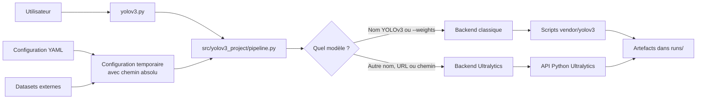
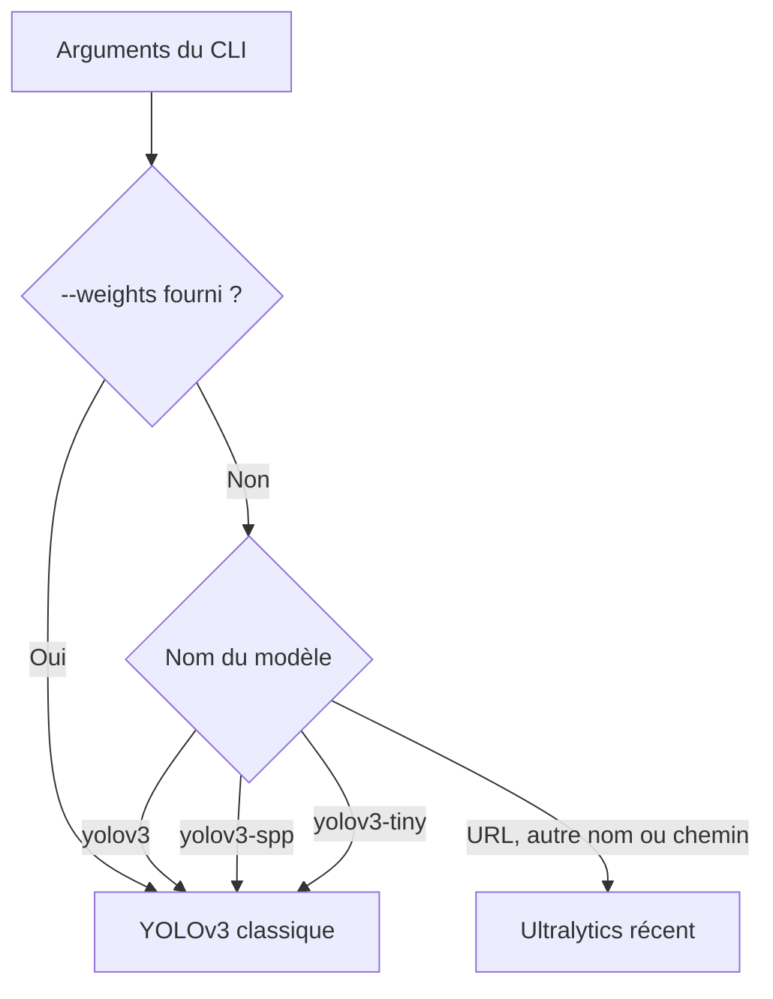
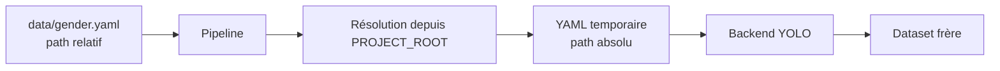
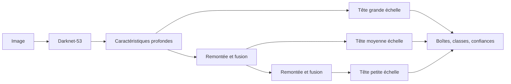
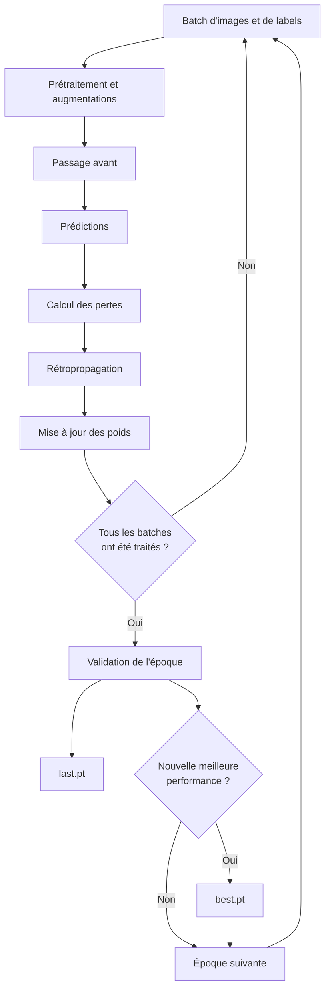
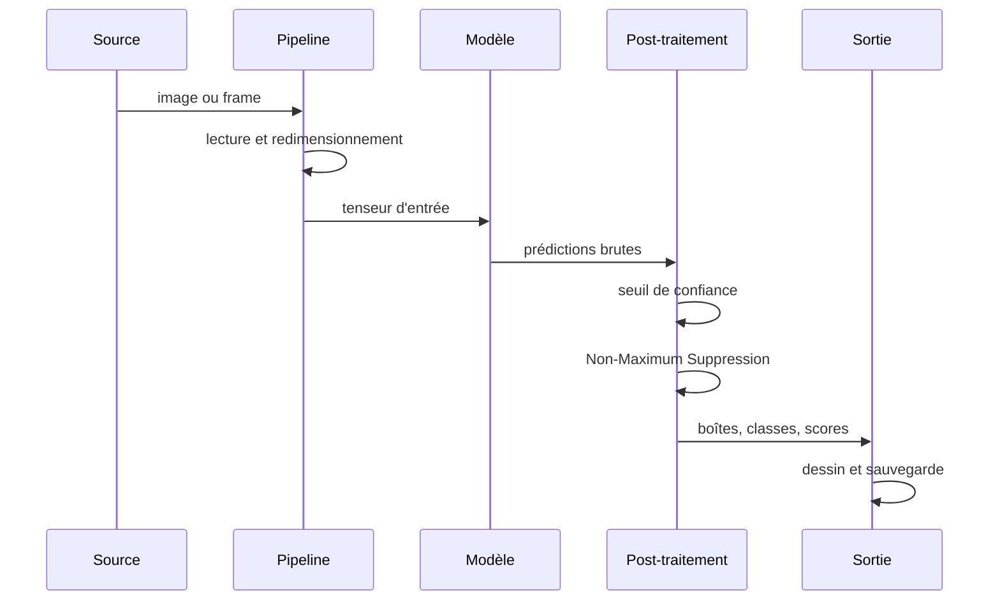
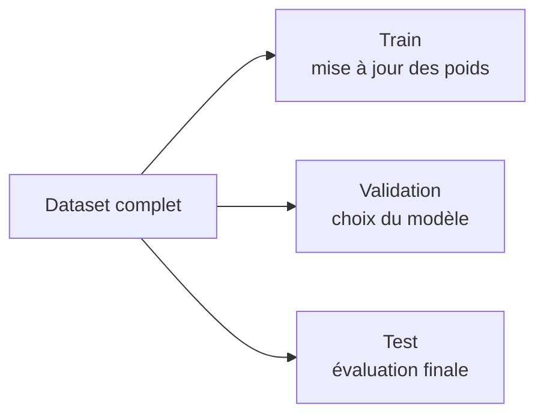
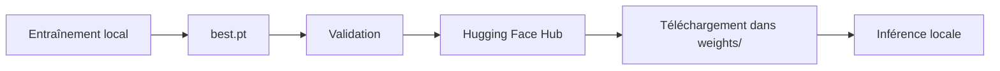

# Explication technique du projet

Ce document décrit le fonctionnement interne du projet : architecture
logicielle, détection d'objets, entraînement, inférence, validation, gestion des
données et limites. Les commandes directement utilisables sont regroupées dans
le [README principal](../README.md).

## 1. Vue d'ensemble

Le projet présente une interface commune devant deux implémentations :

1. **YOLOv3 classique**, lancé comme un ensemble de scripts externes depuis
   `vendor/yolov3` ;
2. **Ultralytics récent**, appelé directement par l'API Python
   `ultralytics.YOLO`.

Cette couche d'abstraction permet de comparer plusieurs générations de modèles
sans réécrire toutes les commandes d'entraînement, de validation et
d'inférence.



## 2. Architecture logicielle

### 2.1 Point d'entrée

`yolov3.py` ajoute le dossier `src/` au chemin Python puis appelle
`yolov3_project.pipeline.main`. Le même point d'entrée est exposé sous la forme
d'une commande console `yolov3` par `pyproject.toml`.

### 2.2 Analyse des arguments

Le parser définit quatre sous-commandes :

- `check` : vérification de l'environnement ;
- `train` : entraînement ou fine-tuning ;
- `predict` : inférence ;
- `val` : évaluation quantitative.

Les options communes sont traduites vers les paramètres spécifiques du backend
sélectionné.

### 2.3 Sélection du backend



L'option `--weights` est conservée pour la compatibilité avec les checkpoints
du dépôt YOLOv3 historique. Pour les modèles récents, un checkpoint est fourni
avec `--model chemin/vers/best.pt`.

### 2.4 Exécution du backend classique

Le pipeline construit une commande avec l'interpréteur Python courant, puis
lance l'un des scripts suivants dans un sous-processus :

- `vendor/yolov3/train.py` ;
- `vendor/yolov3/detect.py` ;
- `vendor/yolov3/val.py`.

Le répertoire de travail du sous-processus est la racine du projet. Cela évite
que le résultat dépende du dossier depuis lequel l'utilisateur a lancé la
commande.

### 2.5 Exécution du backend moderne

Le modèle est chargé par `ultralytics.YOLO`. Le pipeline appelle ensuite :

- `YOLO.train(...)` ;
- `YOLO.predict(...)` ;
- `YOLO.val(...)`.

L'inférence moderne utilise le mode `stream=True`, ce qui permet de consommer
progressivement les résultats d'une vidéo ou d'une webcam au lieu de conserver
toutes les frames en mémoire.

## 3. Séparation du code et des données

Les datasets occupent plusieurs gigaoctets et évoluent différemment du code.
Ils sont donc stockés dans un dossier frère :

```text
AI/
├── AI-Detection-YOLO/
└── AI-Detection-YOLO-Dataset-Preparation/
```

Cette organisation apporte plusieurs avantages :

- le dépôt Git reste léger ;
- les données brutes ne risquent pas d'être committées ;
- plusieurs expériences peuvent partager les mêmes images ;
- les outils de préparation restent séparés du runtime d'entraînement ;
- les checkpoints et vidéos restent locaux ou sont envoyés sur un stockage
  dédié.

### 3.1 Résolution portable des chemins

Les fichiers `data/*.yaml` utilisent des chemins relatifs à la racine du dépôt.
Avant `train` ou `val`, le pipeline :

1. charge le YAML avec PyYAML ;
2. résout la clé `path` depuis la racine du projet ;
3. crée un fichier YAML temporaire avec un chemin absolu ;
4. transmet ce fichier au backend ;
5. supprime le fichier temporaire à la fin de la commande.

Cette étape est nécessaire, car les backends classique et moderne n'utilisent
pas toujours le même répertoire comme origine des chemins relatifs.



## 4. Principes de la détection YOLO

### 4.1 Sortie d'un détecteur

Pour chaque objet, un détecteur produit :

- les coordonnées d'une boîte englobante ;
- une classe ;
- une confiance.

La classification seule ne localise pas les objets. La détection doit résoudre
simultanément la question « quoi ? » et « où ? ».

### 4.2 Approche one-stage

YOLO signifie *You Only Look Once*. Les détecteurs YOLO sont dits *one-stage* :
un passage du réseau produit directement les prédictions. Cette approche évite
une étape séparée de proposition de régions et favorise l'inférence en temps
réel.

### 4.3 YOLOv3 et Darknet-53

YOLOv3 classique s'appuie sur Darknet-53 pour extraire les caractéristiques de
l'image. Les détections sont produites à plusieurs résolutions afin de mieux
représenter les objets de tailles différentes.



Les détails exacts des modèles Ultralytics récents dépendent de l'architecture
chargée. Le pipeline ne suppose pas qu'ils partagent l'architecture interne de
YOLOv3 ; il uniformise uniquement leur interface d'utilisation.

## 5. Représentation des annotations

### 5.1 Arborescence

```text
dataset/
├── images/
│   ├── train/
│   ├── val/
│   └── test/
└── labels/
    ├── train/
    ├── val/
    └── test/
```

Une image et son label possèdent le même nom de base :

```text
images/train/exemple.jpg
labels/train/exemple.txt
```

### 5.2 Coordonnées normalisées

Chaque ligne de label suit ce format :

```text
class_id x_centre y_centre largeur hauteur
```

```text
Image de largeur W et hauteur H
┌──────────────────────────────────────┐
│                                      │
│       (x_min, y_min)                 │
│             ┌─────────────┐          │
│             │      ×      │          │
│             │ (x_c, y_c)  │          │
│             └─────────────┘          │
│                    (x_max, y_max)    │
│                                      │
└──────────────────────────────────────┘
```

```text
x_centre = ((x_min + x_max) / 2) / W
y_centre = ((y_min + y_max) / 2) / H
largeur  = (x_max - x_min) / W
hauteur  = (y_max - y_min) / H
```

Les valeurs sont comprises entre `0` et `1`. Le `class_id` doit correspondre à
une entrée de `names` dans le fichier YAML.

## 6. Cycle d'entraînement



### 6.1 Époque et batch

- un **batch** est un groupe d'images traité avant une mise à jour des poids ;
- une **époque** correspond à un passage complet sur le jeu d'entraînement ;
- la taille du batch est limitée principalement par la mémoire disponible.

### 6.2 Fonction de perte

Les implémentations YOLO combinent généralement plusieurs objectifs :

- erreur de localisation des boîtes ;
- erreur d'objectness, c'est-à-dire la présence probable d'un objet ;
- erreur de classification ;
- selon l'architecture récente, termes supplémentaires propres au backend.

La forme exacte de la perte n'est pas réimplémentée dans ce projet : elle est
calculée par le backend choisi.

### 6.3 Fine-tuning

Le fine-tuning initialise le réseau avec des poids appris sur un dataset plus
large, par exemple COCO. Les représentations de formes, textures et objets sont
ensuite adaptées aux nouvelles classes.

Cette stratégie est adaptée lorsque :

- le dataset personnalisé est relativement petit ;
- les images restent proches du domaine visuel des poids pré-entraînés ;
- on souhaite réduire le temps d'entraînement.

### 6.4 Entraînement depuis zéro

L'option `--scratch` initialise une architecture sans poids pré-entraînés. Elle
est utile pour une étude comparative, mais demande généralement davantage de
données, de temps et de réglage.

### 6.5 Gel de couches

`--freeze N` empêche la mise à jour des premières couches. Les caractéristiques
génériques restent fixes tandis que les couches plus proches de la sortie
s'adaptent au nouveau dataset. Le comportement exact dépend du backend.

### 6.6 Résolution et augmentation

Une résolution élevée conserve davantage de détails, mais augmente :

- la mémoire utilisée ;
- le temps de calcul ;
- le coût de l'entraînement et de l'inférence.

Les augmentations simulent différentes conditions visuelles. Elles améliorent
souvent la généralisation, mais des transformations irréalistes peuvent aussi
dégrader le modèle.

## 7. Pipeline d'inférence



### 7.1 Prétraitement

L'image est chargée, redimensionnée à la taille `--imgsz`, convertie en tenseur
et normalisée selon les attentes du backend.

### 7.2 Seuil de confiance

`--conf` élimine les détections trop incertaines. Un seuil faible augmente le
rappel mais produit plus de faux positifs. Un seuil élevé produit moins de
détections, souvent plus fiables, mais peut manquer des objets.

### 7.3 Non-Maximum Suppression

Plusieurs boîtes peuvent représenter le même objet. La NMS conserve la boîte la
plus pertinente et supprime les boîtes très recouvrantes de score inférieur.

### 7.4 Vidéos et streaming

Une vidéo est traitée frame par frame. `--vid-stride N` ne traite qu'une frame
sur `N`, ce qui réduit le temps de calcul au prix d'une résolution temporelle
plus faible.

Le mode streaming du backend moderne évite de conserver tous les résultats en
mémoire.

## 8. Validation et métriques

### 8.1 Intersection over Union

L'IoU mesure le recouvrement entre une boîte prédite et une boîte réelle :

```text
IoU = aire(intersection) / aire(union)
```

Une IoU proche de `1` indique un fort recouvrement.

### 8.2 Vrais et faux résultats

| Situation | Interprétation |
|---|---|
| vrai positif | objet correctement détecté et associé |
| faux positif | détection sans objet correspondant |
| faux négatif | objet réel non détecté |

```text
précision = vrais positifs / (vrais positifs + faux positifs)
rappel    = vrais positifs / (vrais positifs + faux négatifs)
```

### 8.3 Average Precision et mAP

L'Average Precision résume la courbe précision-rappel d'une classe. La mAP est
la moyenne des AP sur les classes.

- **mAP@0.5** : association acceptée à partir d'une IoU de 0,5 ;
- **mAP@0.5:0.95** : moyenne sur plusieurs seuils, donc mesure plus stricte.

Aucune métrique unique ne suffit. Il faut observer :

- précision et rappel par classe ;
- matrice de confusion ;
- courbes précision-rappel ;
- exemples de faux positifs et faux négatifs ;
- performances sur des conditions différentes du dataset d'entraînement.

## 9. Séparation train, validation et test



- `train` sert à calculer les gradients ;
- `val` sert à suivre la généralisation et choisir `best.pt` ;
- `test` doit rester indépendant jusqu'à l'évaluation finale.

Une fuite de données apparaît si une même image, ou des frames presque
identiques d'une même vidéo, se retrouvent dans plusieurs splits. Les métriques
deviennent alors artificiellement optimistes.

## 10. Artefacts et cycle de vie des modèles

Un entraînement produit notamment :

```text
runs/train/experience/
├── weights/
│   ├── best.pt
│   └── last.pt
├── args.yaml
├── results.csv
├── results.png
└── confusion_matrix.png
```

- `best.pt` est destiné à l'évaluation et à l'inférence ;
- `last.pt` est utile pour reprendre un entraînement ;
- `args.yaml` décrit la configuration ;
- les courbes permettent de diagnostiquer sous-apprentissage et
  surapprentissage.

Les checkpoints sont exclus de Git. Leur destination recommandée est un dépôt
de modèles Hugging Face accompagné d'une model card.



## 11. Reproductibilité

Une expérience reproductible doit conserver :

- la version du code ;
- la version de Python, PyTorch, Torchvision et Ultralytics ;
- le checkpoint initial ;
- la configuration YAML ;
- les splits du dataset ;
- la graine aléatoire si elle est exposée ;
- la résolution, le batch size, le nombre d'époques et le périphérique ;
- les métriques et les exemples d'erreurs.

Les calculs GPU ne sont pas toujours parfaitement déterministes. Deux
entraînements avec les mêmes paramètres peuvent produire de légères
différences.

## 12. Limites du projet

### 12.1 Portabilité locale

Les YAML supposent actuellement que le dépôt de code et le dossier de données
sont voisins et conservent leurs noms. Un déplacement nécessite de modifier la
clé `path` des fichiers concernés.

### 12.2 Différences entre backends

L'interface est commune, mais les backends ne sont pas identiques :

- architecture et pertes différentes ;
- options pas toujours interprétées exactement de la même façon ;
- formats de checkpoint potentiellement incompatibles ;
- performances et consommation mémoire différentes.

Un checkpoint moderne ne doit pas être fourni avec `--weights`, réservé au
backend classique.

### 12.3 Dépendance aux annotations

Le modèle apprend les catégories définies par les annotations. Une annotation
manquante, incorrecte ou ambiguë devient un signal d'apprentissage incorrect.
La qualité du dataset est donc aussi importante que l'architecture.

## 13. Considérations éthiques

Le dataset `gender` provient des catégories Open Images `Man` et `Woman`. Les
classes du YAML sont nommées `apparence_masculine` et `apparence_feminine` pour
rappeler qu'il s'agit d'une catégorisation visuelle issue d'annotations, et non
d'une mesure de l'identité de genre.

Le modèle :

- ne connaît pas l'identité d'une personne ;
- reproduit les choix, erreurs et biais du dataset ;
- peut échouer selon l'apparence, le cadrage, le contexte ou la qualité ;
- ne doit pas servir à prendre une décision sensible concernant une personne ;
- ne doit pas être présenté comme une classification objective du genre.

Les performances globales peuvent masquer des écarts importants entre
sous-groupes. Toute démonstration doit documenter les cas d'échec et rester
limitée à un usage pédagogique.

## 14. Pistes d'amélioration

- ajouter des tests unitaires pour la sélection du backend et la résolution des
  YAML ;
- ajouter un fichier de verrouillage des dépendances ;
- produire automatiquement une model card après l'entraînement ;
- enregistrer les expériences dans un outil de suivi ;
- ajouter une commande d'export ONNX ou Core ML ;
- évaluer les métriques par sous-groupe et par condition d'image ;
- rendre le chemin du dossier de datasets configurable par variable
  d'environnement ou option CLI.

## 15. Licence

Le code Ultralytics présent dans `vendor/yolov3` est distribué sous licence
AGPL-3.0. Les datasets et poids peuvent avoir leurs propres licences et
conditions d'utilisation. Elles doivent être vérifiées avant toute
redistribution ou utilisation non pédagogique.
